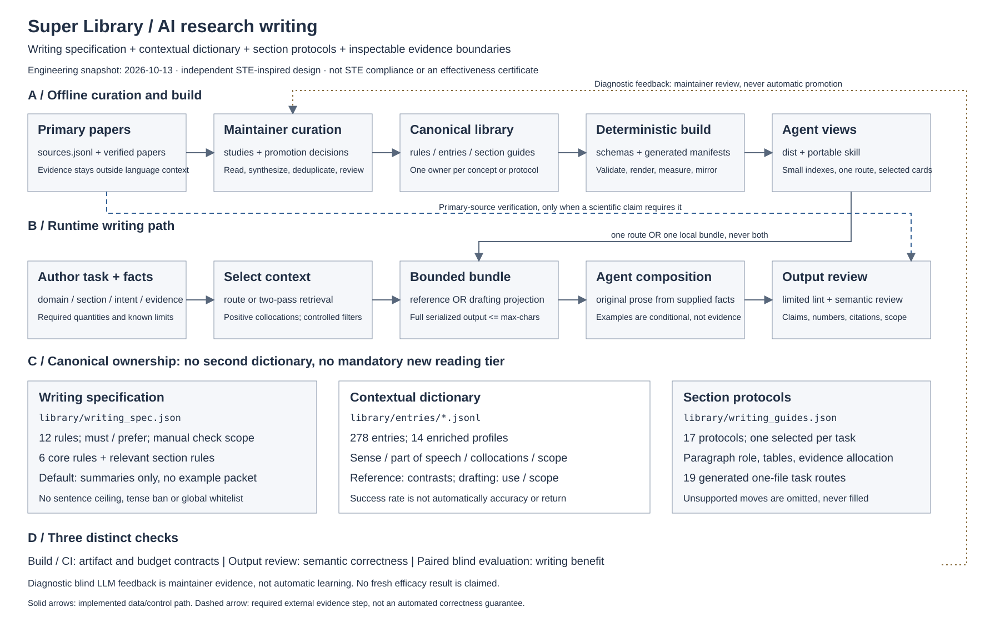

# AI 科研写作规格：STE-inspired，不是 STE 合规版

## 设计图



图中实线表示已实现的数据／调用路径；虚线表示写作时必须按需执行的
一级来源核验，不表示程序能自动证明结论正确。评测反馈由维护者审核后
转成版本化改动，不存在自动吸收模型输出的“学习闭环”。

## 学习了什么，哪些没有照搬

Karpathy 的完整帖子强调降低人类理解和检查模型输出的成本，并讨论
受控语言、图、交互网页和讲解视频。这是输出可理解性的动机，不是
STE 提升顶会论文质量的实验依据。原始 X 页面返回 403；本轮通过公开
只读 FxTwitter 接口读取完整正文。仅记录来源，不保存帖文全文。

- 原帖：https://x.com/karpathy/status/2105819303471976479
- 公开读取：https://api.fxtwitter.com/karpathy/status/2105819303471976479
- 官方 PDF：https://www.asd-ste100.org/assets/files/ASD-STE100_ISSUE9.pdf
- PDF 身份 SHA-256：`d1f4ea9e7cd6e46b47aa9057209f99e78c0e9cfc4e27a5b07895b05c1a166431`
- 阅读日期：2026-10-12；Issue 9（2025-01-15）。

本轮核对了官方词汇规则、动词规则、句子规则、描述性写作、写作实践，
以及词典的词性／含义／用法说明。具体来源定位与独立迁移如下：

- Part 1, Section 1, Rules 1.2–1.3、1.8、1.11：迁移为词性、操作性含义、
  领域术语与同一概念的命名一致性，不给所有 AI 文献强加唯一全局词义。
- Section 2, Rules 2.1–2.2：保留减少歧义的目的，不强拆正式技术名词。
- Section 3, Rules 3.2、3.5–3.7：迁移为明确主谓与直接动词，不禁用科研
  写作合理需要的被动、完成时或 -ing 专业词。
- Section 4, Rules 4.1–4.5：迁移为清楚的句子依赖、完整限定与真实衔接；
  不通过删除冠词、条件或不确定性追求短句。
- Section 6, Rules 6.1–6.6：迁移为逐步引入信息与单段论点，不采用统一
  字数／句数上限，也不把并列事实的堆积误当成叙事。
- Section 9, Rule 9.1、9.4：迁移为必要时重组句子，而非逐词替换；保留
  术语与风格一致性。
- Part 2, pp. 2-0-3–2-0-6、2-0-12：迁移词性、语义范围、搭配与带理由
  的条件性正反例。截图把 approximately / about 的限制方向画反；本轮
  以官方材料为准，且不把 STE 通用词表当作 AI 论文禁词表。

ASD 保留标准的版权。本实现为独立方法归纳，未重新分发 PDF、词典或
规则原文，未复制第三方 Skill；不存在 STE 认证或授权的声明。

## 两个数据源，三个职责

`library/writing_spec.json` 维护 12 条稳定编号规则，分为 `must` 与
`prefer`：前者约束保真和证据边界，后者帮助清晰表达。两类都标明检查
边界，不能把“硬规则”理解为“已被机器验证”。现有章节协议继续负责
段落顺序、实验报告和表格结构；规格不替代章节协议。

字典仍由 `library/entries/*.jsonl` 单独拥有。可选 `lexical_profile`
补充词性、操作性含义、常见搭配、不可随意互换的表达、规则引用，
以及同一假设事实下的误用／推荐／修改理由。每个正反例都由维护者原创，
是条件性教学材料，不是源论文原句、真实测量或评分标准答案。

本轮是 **6 条示范性增强**，不是全部 276 条都已有这种细粒度剖析：
world model、learned dynamics model、sample efficiency、task success rate、
significance 用法及 effectiveness 分析。旧记录不带此字段仍然有效。
没有增加论文数量，也没有增加近义重复词条。

## Agent 的低成本入口

```bash
python3 scripts/superlib.py spec --list
python3 scripts/superlib.py spec experiments --max-chars 12000
python3 scripts/superlib.py show emb.term.task-success-rate.001
python3 scripts/superlib.py bundle \
  --rhetoric-query "finding led experimental narrative" \
  --technical-query "task success rate" \
  --domain embodied_ai --section experiments --intent evidence \
  --guide experiments.analysis --limit 4 --max-chars 24000
```

`spec` 用于检查一种规格，不是写作前新增的必读步骤。普通 bundle 自动
包含 6 条通用规则与当前章节适用摘要，不包含规则正反例或调研全文。
一个已检索词条的语义剖析随该词条返回，不读取整本字典。guide-only
仍不取词条；其适用规则根据已选协议的章节确定。

所有新增上下文纳入现有 Markdown / JSON 序列化字符预算。无法容纳
完整所选规格和协议时返回 exit 2、空 stdout，不截断约束。新增摘要
曾挤占旧 12,000 字符回归用例；修复是压缩实验分析协议的重复表述，
没有扩大门槛或删除关键反例、独立段落保真和因果边界。

`dist/specs/` 和独立 Skill 的 `references/specs/` 是生成的可选检查视图；
核心／单文件路由已经带相应摘要，不要再叠加整份规格。旧 `v0.4.0`
标签未更新；新行为需要使用本轮功能分支 checkout。

## 怎么判断工程设计合理

- 单一所有者：通用规则、术语记录、章节协议分别有规范数据源。
- 依赖方向：规范数据经过验证再生成 Agent 视图；生成文件不是编辑源。
- 检索边界：一个协议、少量词条、完整输出预算，研究和证据地图不默认加载。
- 语义边界：语言条目不能充当科学证据，样例的实体与数据不能进入结果叙述。
- 检查边界：结构测试、措辞 lint、科学语义审核、真实写作盲评不是同一件事。
- 更新边界：失败样例经人工审核与去重后进入改动，不自动扩大字典或放宽门槛。

架构备选与取舍见 [ADR-006](adr/ADR-006-ai-writing-spec-and-semantic-dictionary.md)。
SVG 是仓库内可版本审查的静态图；交互 Canvas 是阅读伴侣，不影响检索。
尚未进行新的双臂生成或独立人类盲评；本轮不能宣称已提升真实论文专业度。

## 本轮技术验收

- `make check`：94 项测试通过；42/42 检索用例通过；重建无生成漂移。
- 新增 10 项规格／字典合同测试，包括旧记录兼容、错误引用、危险标记、
  单规格输出、guide-only、双格式预算、独立 Skill 镜像，以及图中路径和数量。
- Python 编译与 `git diff --check` 通过；没有新增依赖、模型调用或密钥。
- core 为 12,143 字节；实验分析协议为 8,917 字节；所检验实验单路由
  均保持低于原有 24,000 字节门槛。字符预算与 token 数不是同一单位。
- SVG 在完整 1800×1120 WebKit 视口渲染并人工检查；交互 Canvas 通过
  严格 TypeScript 检查，但未对实际 IDE 宿主中的交互做自动化测试。
- 只对本仓库的原生治理、镜像和运行合同做了验证；未更新全局 Forge
  Skill 注册表或执行全局安装。没有把这种边界写成全局治理认证。
- 对应远端 CI 必须绑定实际交付 commit 查询，不能从本地通过推断。
- 真实写作效果、盲评偏好和跨模型收益仍未验证。
