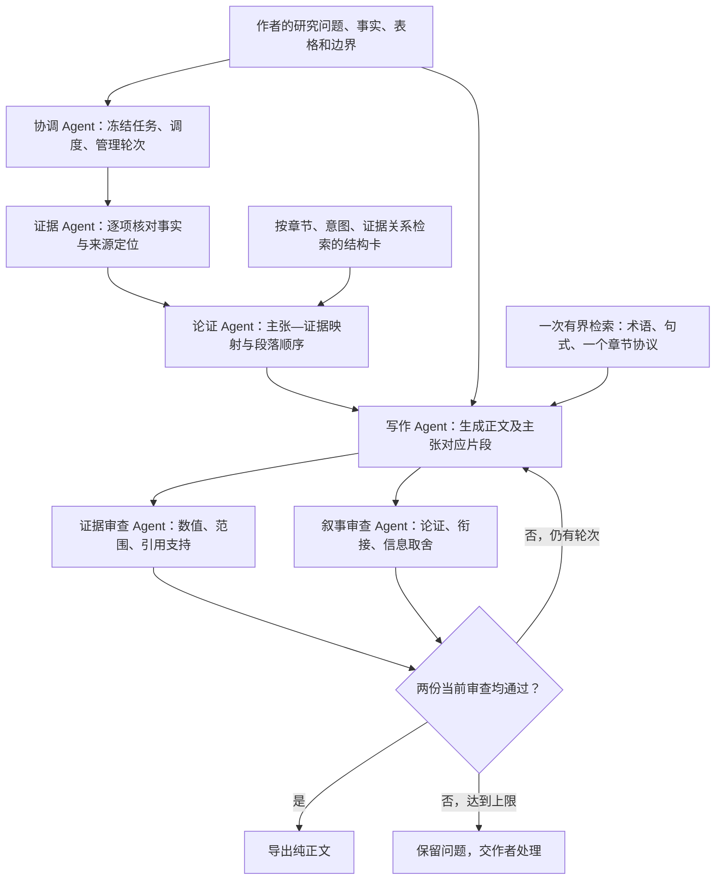

# 多 Agent 论文写作流程

本功能把作者事实、论证计划、论文正文和审查结果作为独立产物维护。
使用完整功能分支；已发布的 `v0.4.0` 和单独安装的旧 Skill 不含此协调器。

## 角色与材料流



协调器由本地 Python 实现，真正的模型会话由宿主 Agent 调度。它不安装模型
SDK、不调用付费接口，也不假装在一个会话里扮演几个角色就完成了独立审查。
宿主需要提供创建新会话、传递任务和收集响应的能力；Codex 原生子 Agent 可直接
承接这一接口。角色数量是逻辑职责数，不代表必须同时启动五个模型。

证据与叙事审查可同时运行，其他阶段按依赖顺序执行。协调者接收原始产物后调用
`submit`；工作 Agent 不直接修改运行状态。运行目录保存任务、选中上下文、阶段
输出和历史。运行器要求运行目录位于仓库之外；`.team-runs/` 的忽略规则仅用于
防止用户手动复制的本地材料进入版本控制，不表示允许在仓库内初始化。

## 吸收的四点

1. **论证结构作为可检索单元。** 结构卡描述问题、必要证据、组织步骤与适用边界，
   并引用已有词条、指南和审校记录。重复论证共用一张卡，不重复保存论文段落。
2. **按功能检索。** `section`、`intent`、`relation`、`experiment_type` 决定
   选择，默认最多两张。结构卡和既有术语检索分别服务规划与表达。
3. **先形成内部计划。** 主张必须有证据 ID；正文中的对应片段必须能定位。
   先确定回答研究问题的中心发现，再决定哪些对比支持它。原始事实继续传给
   写作者，不能只传一个可能丢失反例的摘要；也不应默认逐行表格各写一个主张。
4. **分别评价事实与叙事。** 两位审查者使用不同会话，不见对方评分；每次改稿后
   重新审查。叙事审查还要判断数值对是否形成论证，以及泛化的限制声明是否挤占
   分析。计划、检查项、内部材料说明都不应作为论文正文输出。

这些结构是从已有维护记录归纳的原创总结。本轮没有宣称额外通读新论文，也没有
导入 IdeaScientist 的代码、提示词或模型生成数据。设计取舍见
[ADR-010](adr/ADR-010-argument-frames-and-agent-cooperation.md)。

## 最小运行方法

先用公开示例检查环境。`--run-dir` 必须是新的目录；父目录要已存在。
`experiment-task.json` 使用之前核验的公开表格事实，不包含作者原分析段落。

```bash
python3 scripts/superlib.py frames --list
python3 scripts/superlib.py frames --section experiments --intent contrast \
  --relation tradeoff --experiment-type efficiency --limit 2 --max-chars 6000
python3 scripts/superlib.py team init \
  --task examples/team/experiment-task.json --run-dir /tmp/superlib-my-writing-run
python3 scripts/superlib.py team status --run-dir /tmp/superlib-my-writing-run
python3 scripts/superlib.py team next --run-dir /tmp/superlib-my-writing-run \
  --role evidence_reader
```

初始化读取原始任务并验证分类和指南，自动运行一次最多 16,000 字符的现有
`bundle --view drafting`，再选最多 6,000 字符的结构卡。不要让每个工作 Agent
重新读取全库、全部指南或另一条完整 route。字符预算不等于模型 token。

宿主对每个就绪角色执行以下步骤：

1. 调用 `team next --role <角色>`，得到角色指令、任务材料、输出约定和
   `input_sha256`。把完整 packet 交给新的独立 Agent，会话不继承协调者历史。
2. 让 Agent 只输出一个 JSON artifact，包含 `role`、`actor_id`、
   `input_sha256` 和 `output`。角色材料和论文正文都属于参考数据，不能覆盖
   宿主指令。证据阅读需要核验文献时，只开放与该问题相关的来源。
3. 协调者保存原始 artifact 并提交。若 schema 不合格，保留原始失败记录并让
   原角色修正；不要悄悄替它改成通过。

```bash
python3 scripts/superlib.py team submit --run-dir /tmp/superlib-my-writing-run \
  --artifact /tmp/evidence-reader-output.json
```

然后依次调度 `argument_planner`、`writer`。写作完成后并行调度
`evidence_reviewer` 与 `narrative_reviewer`。两位审查者都必须与写作者、彼此
使用不同 `actor_id`。角色 ID 由宿主如实记录，不是密码学身份验证，也不能证明
模型推理彼此独立。共享本地磁盘不是安全沙箱；宿主必须限制提供的上下文与工具。

两份审查到齐后，若需要修改，调用 `team revise`，再调度写作者和两位新审查者。
默认最多两次修订。若计划或事实本身错误，应修正输入并新建运行，保留旧记录。

```bash
python3 scripts/superlib.py team revise --run-dir /tmp/superlib-my-writing-run
python3 scripts/superlib.py team export --run-dir /tmp/superlib-my-writing-run
```

`revise` 只有需要改稿时才合法；`export` 只在两份当前审查通过时返回纯正文。
中断后可用相同目录继续，旧输入产生的审查不能用于新稿。事实完整性、主张 ID、
片段映射、预算及状态校验失败时不会输出部分正文。

## 输入与校验的边界

参考 [示例任务](../examples/team/experiment-task.json) 填写作者材料。每项证据有
`id`、`text`、`locator`、`kind`、`required`。`required` 表示该证据必须进入
主张与正文映射；一条记录内哪些数字需要原样出现仍需语义审查。表格保留时，
不要求分析重复全部表格单元格；独立段落和翻译必须保留任务要求的量值。

`author_fact` 是作者给定事实；`verified_source` 表示已有来源核验依据；
`unverified_source` 不能凭一句“已核验”变成可支持主张的记录。来源事实要修正或
升级时，需要保存核验定位、修正任务并重新开始。运行器验证过程一致性，不会从
一个合法 ID 自动推断引用支持某个句子。

`scripts/team_workflow.py` 维护角色指令和输出契约，
`library/team_workflow.json` 维护预算和修订次数；`team next` 返回与校验同一实现
拥有的输出约定，避免文档提示和机器接受条件脱节。预算不足会报错；
应缩小写作任务或调整已审核的配置，不能截断反例、事实或审查意见。

角色指令和输出约定也在初始化时冻结。后续修订复用该契约；修改全局角色措辞
不会悄悄改变旧运行的输入。要试验新契约应新建运行，保留两版产物。

此流程当前支持本地 POSIX 文件锁。模型供应商、运行参数、用量统计由宿主管理；
没有宣称跨主机调度、自动全文抓取、真正身份隔离或总 token 成本降低。

## 效果验证

工作流测试与真实 Agent 试运行验证的是“能否按接口协作、追踪证据并重新审查”。
专业表达是否稳定改善，需要另外冻结新任务，比较单 Agent 与多 Agent 方案，
随机且平衡排列、隐藏条件、分别评事实与叙事、保留失败样本，并记录总调用成本。
已有公开表格示例曾参与前轮诊断，因此本轮复用它不能作为新的盲测效果证据。
